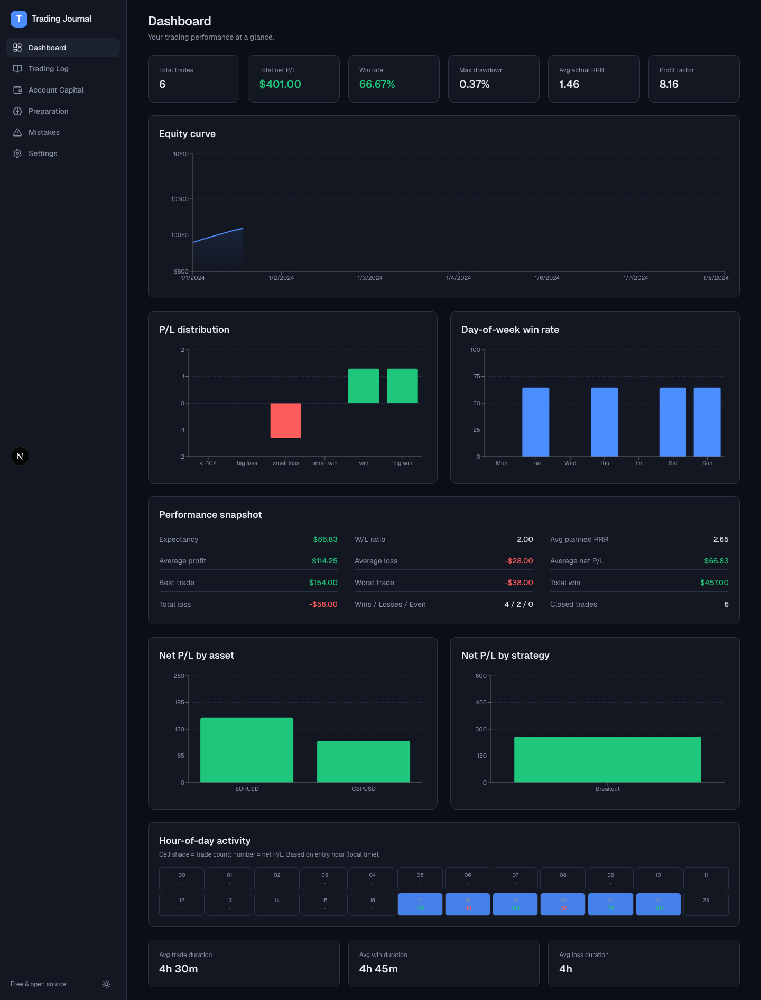
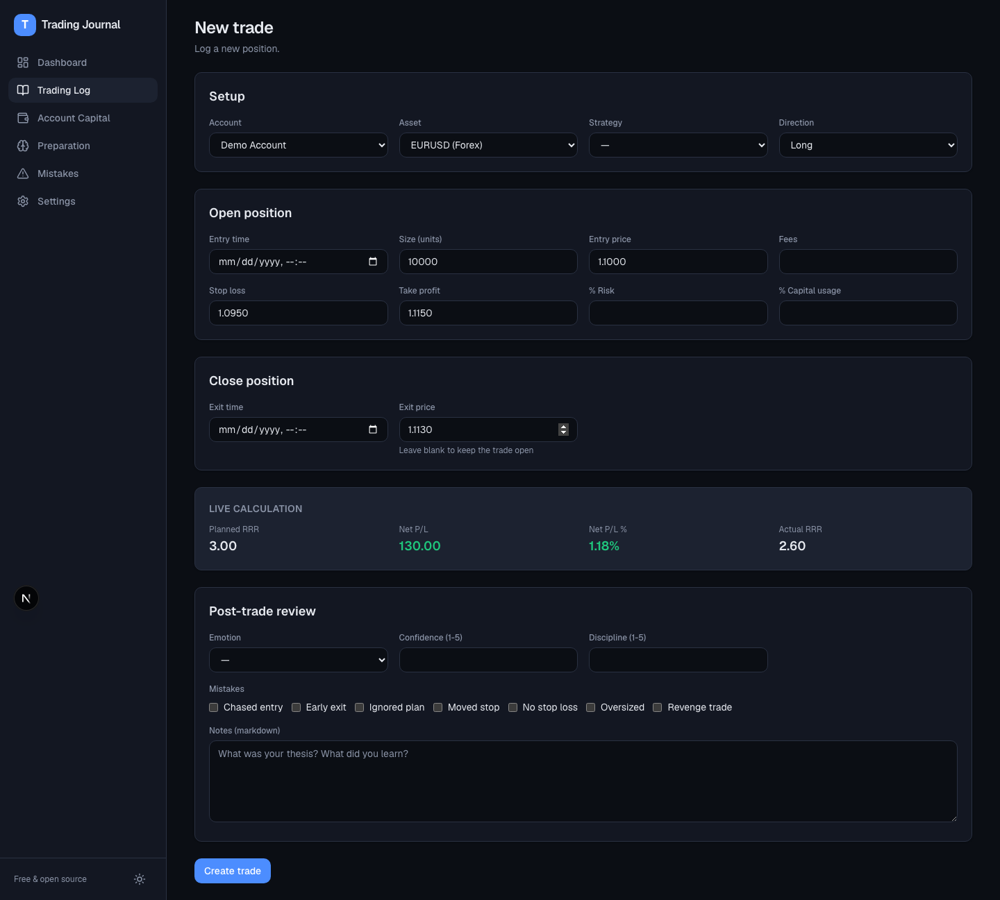
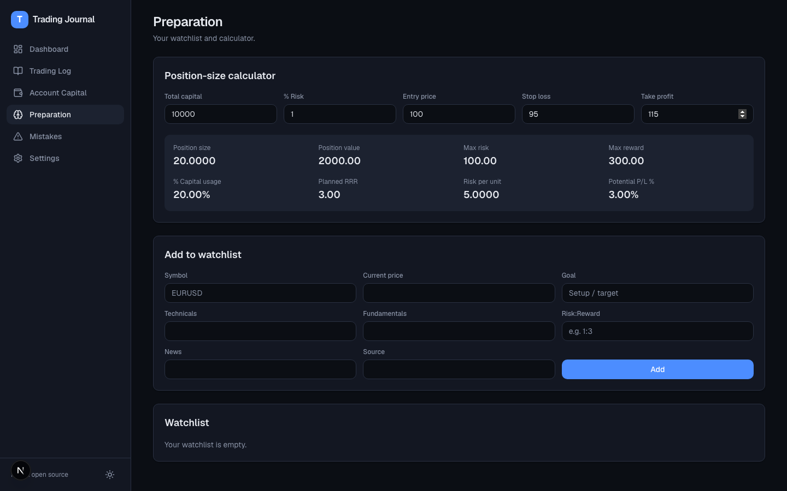

# Trading Journal

A free, open-source, self-hostable trading journal & analytics app — a lightweight
alternative to tools like [Tradervue](https://www.tradervue.com/). Log your trades,
attach chart screenshots, tag mistakes and emotions, and see your performance broken
down by win rate, R-multiple, drawdown, day-of-week, time-of-day, asset and strategy.

Built as a single Next.js app with a local SQLite database, so you can run it on your
own machine with zero external services.

## Features

- **Trading Log** — log open/closed positions with live-computed P/L, RRR and duration; per-trade notes, chart screenshots, emotion, confidence/discipline scores and mistake tags.
- **CSV import** — bulk-import trades from broker exports (generic, MetaTrader and IBKR column layouts are auto-detected) with a live preview before committing.
- **Dashboard** — net P/L, win rate, profit factor, expectancy, max drawdown, equity curve, P/L distribution, day-of-week & hour-of-day breakdowns, and per-asset / per-strategy performance.
- **Account Capital** — track deposits/withdrawals and an equity curve per account.
- **Preparation** — a watchlist and a position-size / risk calculator.
- **Setup** — manage accounts, assets, strategies, emotions, mistakes and goals.
- Dark / light theme.
- **Trading calendar** — browse monthly realized P/L by UTC exit date and open the underlying trades for any active day.
- **Review & lessons** — compare planned and actual R alongside confidence, discipline, and trade notes.
- **Currency-aware dashboard** — filter by currency and account so balances in different currencies are never added together. Dashboard metrics cover all time; the calendar has its own month navigation.
- **Responsive workspace** — light theme by default, with a desktop sidebar and horizontal navigation on smaller screens.

All monetary math runs through `decimal.js` (no binary-float rounding), and every
analytics formula is a pure function covered by unit tests.

## Connected trading workflow

1. In **Preparation**, choose an account and asset. The calculator uses realized account equity (capital events plus closed-trade net P/L), then carries the position size, direction, entry, stop, target and leverage into **Create trade**.
2. The trade form recalculates risk and margin against the selected account. Saved risk percentages are calculated on the server; they are snapshots of current realized equity, not historical entry-time equity.
3. In **Trading Log**, use **Open positions**, **Closed**, or **To review**. Select a symbol to open the keyboard-accessible detail panel, close a position, or complete a review.
4. Closing a position requires an exit price and time and accepts exit fees. A completed review requires notes plus confidence and discipline scores. Existing closed trades start unreviewed.
5. Account, asset, strategy, and UTC entry-date filters carry between Dashboard and Trading Log through navigation. Calendar drill-down adds a UTC exit-date filter. Account equity and drawdown remain explicitly all-time.

Bybit transaction-log imports support opening fills, with explicit UTC / UTC+8 selection, wallet-row exclusions, and duplicate TradeId detection within the selected account. Symbols with closing fills require a complete trade-history export; this version does not reconstruct partial exits. Leverage and stop/target values missing from the export must be reviewed after import.

## Screenshots

| Dashboard | Trade entry | Position calculator |
| --- | --- | --- |
|  |  |  |

## Tech stack

Next.js 16 (App Router) · TypeScript · Prisma 7 + SQLite · Tailwind CSS v4 · Recharts · Vitest

## Quickstart

Requires Node.js 20+.

```bash
npm install
cp .env.example .env
npx prisma migrate dev      # create the SQLite database
npm run db:seed             # optional: demo account + sample trades
npm run dev                 # http://localhost:3000
```

## Scripts

| Command | Description |
| --- | --- |
| `npm run dev` | Start the dev server |
| `npm run build` / `npm start` | Production build / serve |
| `npm test` | Run the unit tests (analytics + calculator) |
| `npm run db:migrate` | Apply Prisma migrations |
| `npm run db:seed` | Seed default data + demo trades |
| `npm run lint` | Lint |

## Data & storage

- The database is a single SQLite file (`dev.db`) at the project root — easy to back up.
- Uploaded screenshots are stored under `public/uploads/`.
- To use PostgreSQL instead, see the notes in [`.env.example`](.env.example).

## Roadmap

- Multi-user accounts + authentication
- Broker API sync (CSV import already supported)
- Shareable / public trade links
- Mobile PWA
- AI-assisted trade review

## Contributing

Contributions welcome — see [CONTRIBUTING.md](CONTRIBUTING.md).

## License

[MIT](LICENSE)
